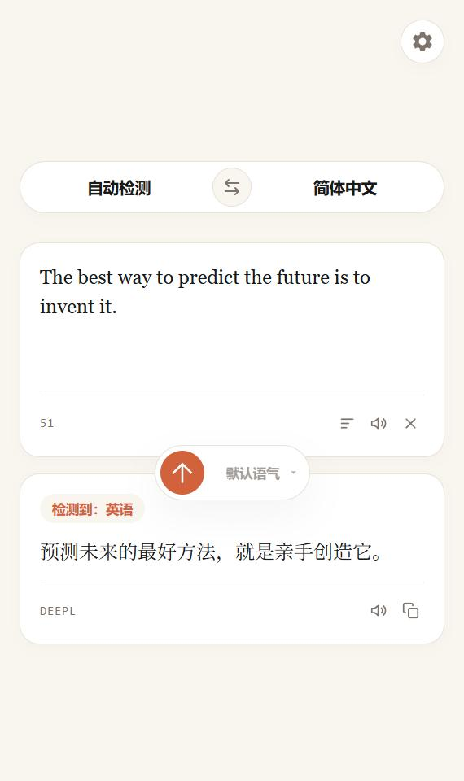
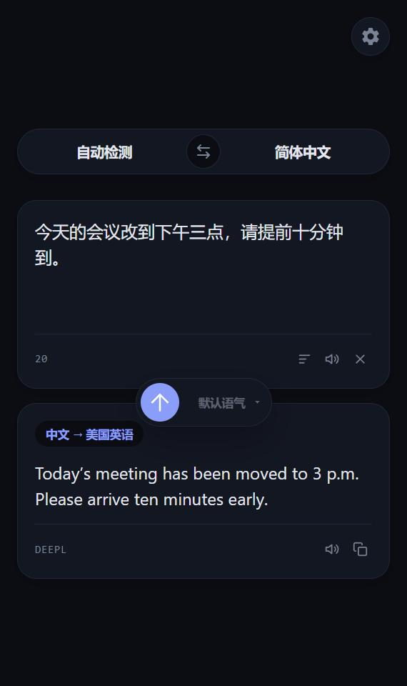
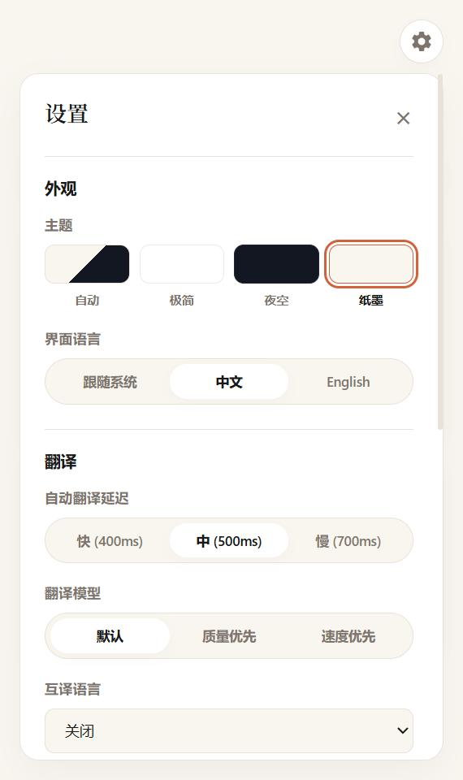

# Sidebar Translator

住在 Opera 侧边栏里的 DeepL 翻译工具。纯原生 HTML / CSS / JavaScript，零依赖，无构建步骤。

<p align="center">
  
  
  
</p>

## 功能

- **边输入边翻译**：停止输入后自动翻译，延迟可调；也可以按 `Ctrl + Enter` 立即翻译。
- **自动检测与智能互译**：源语言自动检测。设置「互译语言」后，输入中文得到英文、输入英文得到中文，不用手动切换方向。
- **朗读**：原文和译文都可以朗读。默认使用系统语音；填写 Gemini API Key 后改用 Gemini 3.8 Flash-Lite TTS，流式播放，长文本也能很快出声。
- **翻译控制**：语气（正式 / 随意）、翻译模型（质量优先 / 速度优先）、自定义指令、上下文补充。
- **主题**：纸墨、极简、夜空三套主题，另有「自动」模式跟随系统深浅色。
- **界面语言**：中文 / English，可跟随系统。
- **始终最新的语言列表**：从 DeepL 获取当前支持的语言，并按语言自动启用或禁用语气等选项。

## 安装

1. 下载或克隆本仓库。
2. 在 Opera 地址栏打开 `opera://extensions`，开启右上角的「开发者模式」。
3. 点击「加载已解压的扩展程序」，选择本仓库所在的文件夹。
4. 在侧边栏设置中启用 Sidebar Translator，点击它的图标即可打开。

## 配置

点击右上角的齿轮打开设置。

| 项目 | 说明 |
| --- | --- |
| DeepL API Key | 必填。在 [DeepL 账户页](https://www.deepl.com/your-account/keys) 获取，Free 和 Pro 的 key 都可以，扩展会自动识别类型并显示已用字符数。 |
| Gemini API Key | 可选，仅用于朗读。在 [Google AI Studio](https://aistudio.google.com/apikey) 获取。留空时使用系统语音。 |
| 互译语言 | 可选。源语言为自动检测时，如果输入内容已经是目标语言，则改译为这里选择的语言。 |
| 自定义指令 | 可选。每行一条，用英语或目标语言书写，例如 `Use a friendly, conversational tone`。最多 10 条，每条不超过 300 字符。 |

## 隐私

- API Key 保存在浏览器本地的 `chrome.storage.local` 中，未加密，仅本扩展的页面可以访问。
- 待翻译的文本只发送给 DeepL；使用 Gemini 朗读时，被朗读的文本会发送给 Google。
- 扩展不收集任何数据，也不请求除上述两个接口之外的任何网络权限。

## 项目结构

```
manifest.json     扩展清单
sidebar.html      侧边栏页面
sidebar.css       样式与主题
sidebar.js        状态、设置与界面逻辑
deepl.js          DeepL API 调用与语言代码处理
tts.js            朗读（Web Speech 与 Gemini TTS）
i18n.js           界面文案（中文 / English）
theme-init.js     首帧前应用主题
_locales/         扩展名称与描述的本地化
```

## 许可

[MIT](LICENSE)
